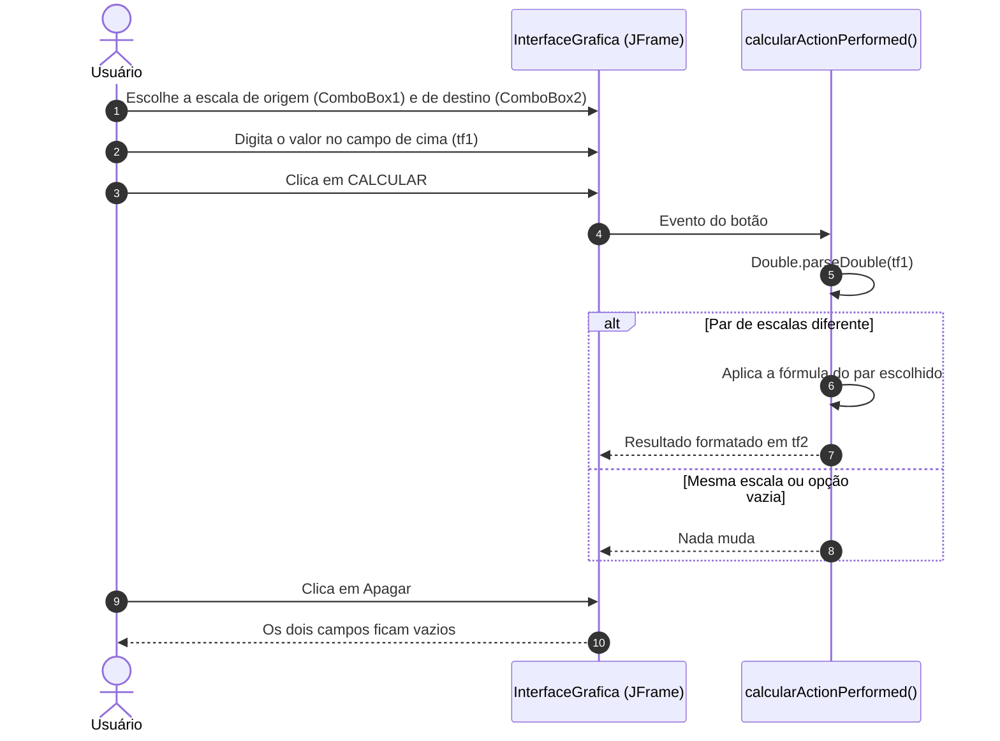
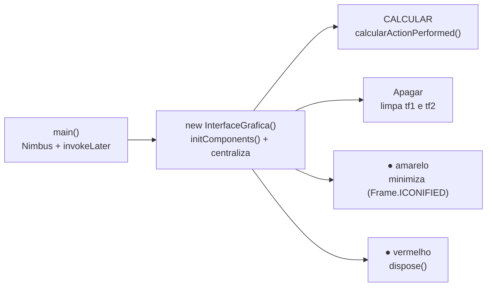

# 🌡️ Temperature Converter Desktop — Conversor de Temperatura em Java Swing


> Um conversor entre Celsius, Fahrenheit e Kelvin com interface gráfica própria em Java Swing.

O **Temperature Converter Desktop** é um projeto pessoal de estudo: uma aplicação desktop em **Java 8** com interface gráfica em **Swing**, criada no editor visual do **NetBeans**. O usuário escolhe a escala de origem e a de destino, digita o valor e clica em **CALCULAR** para ver o resultado convertido. A janela não usa a barra de título do sistema operacional: ela tem cabeçalho, ícone e botões de minimizar e fechar próprios.



---

## ✨ O Problema

Celsius, Fahrenheit e Kelvin aparecem em contextos diferentes (dia a dia, receitas e manuais estrangeiros, física), e converter de cabeça entre eles é fácil de errar: a conversão com Fahrenheit envolve multiplicar por 9/5 e somar 32, e a com Kelvin, somar ou subtrair 273,15.

## 🚀 A Solução

Uma janela única com dois pares "escala + campo":

- **Linha de cima**: escala de origem e o valor a converter.
- **Linha de baixo**: escala de destino e o resultado.
- **CALCULAR** faz a conversão; **Apagar** limpa os dois campos.

## 🎯 Diferenciais

- **Janela personalizada**: `setUndecorated(true)`, cabeçalho azul-escuro, ícone de termômetro e botões circulares (amarelo, cinza e vermelho) desenhados com imagens próprias.
- **Seis conversões**: todos os pares entre as três escalas.
- **Sem dependências**: só a biblioteca padrão do Java (Swing/AWT).
- **Jar pronto**: o `dist/ConversorDeTemperatura.jar` gerado pelo NetBeans está versionado e já inclui as imagens.

---

## 🛠️ Stack Tecnológica

| Camada | Tecnologia |
|---|---|
| **Linguagem** | Java 8 (`javac.source`/`javac.target` = `1.8`; o jar versionado foi gerado com o JDK 1.8.0_291) |
| **Interface** | Swing (`JFrame`, `JComboBox`, `JTextField`, `JButton`, `GroupLayout`) com Look and Feel Nimbus |
| **Bibliotecas** | Apenas a biblioteca padrão do Java |
| **Build** | Ant, pelo `build.xml` gerado pelo NetBeans |
| **IDE** | NetBeans 12.2 (pasta `nbproject/` versionada) |

---

## 🏛️ Arquitetura

O projeto tem uma única classe, `InterfaceGrafica`, que estende `JFrame`. O método `initComponents()` foi gerado pelo editor visual do NetBeans a partir do `InterfaceGrafica.form`; a lógica de conversão fica no tratador do botão CALCULAR.

| Classe | Responsabilidade | Métodos |
| :--- | :--- | :--- |
| `InterfaceGrafica` | Janela, componentes e conversões | `main()`, `initComponents()`, `calcularActionPerformed()`, `apagarActionPerformed()`, `minimizarActionPerformed()`, `fecharActionPerformed()` |



---

## 🧮 Funcionalidades

O valor de `tf1` é lido com `Double.parseDouble` e o resultado vai para `tf2` com `String.format`, usando estas fórmulas e casas decimais:

| De → Para | Fórmula no código | Casas decimais |
| :--- | :--- | :---: |
| Celsius → Fahrenheit | $F = C \times 1{,}8 + 32$ | 0 |
| Celsius → Kelvin | $K = C + 273{,}15$ | 2 |
| Fahrenheit → Celsius | $C = (F - 32) \times 5/9$ | 2 |
| Fahrenheit → Kelvin | $K = (F - 32) \times 5/9 + 273{,}15$ | 3 |
| Kelvin → Celsius | $C = K - 273{,}15$ | 2 |
| Kelvin → Fahrenheit | $F = (K - 273{,}15) \times 9/5 + 32$ | 2 |

Regras e comportamento:

- **Mesma escala nos dois lados** (ex.: Celsius → Celsius) ou a **opção vazia** dos combos: nenhuma conversão é feita e `tf2` fica como estava.
- **Entrada**: o valor precisa estar no formato do `Double.parseDouble` (ponto como separador decimal, ex.: `36.5`).
- **Saída**: o `String.format` usa a localidade do sistema, então em pt-BR o resultado sai com vírgula (ex.: `309,65`).
- **Sem validação**: não há tratamento de entrada vazia ou não numérica nem checagem de valores abaixo do zero absoluto.

---

## 🖥️ Interface (Telas)


*Convertendo 65 °C para Fahrenheit: o resultado `149` aparece no campo de baixo.*

A aplicação tem uma única janela sem borda do sistema, centralizada na tela (`setLocationRelativeTo(null)`), com fundo azul-escuro (`RGB 27, 35, 53`):

| Área | Componentes |
| :--- | :--- |
| **Cabeçalho** | Ícone de termômetro (`Icone(mini).png`), título "Conversor de temperarturas" e três botões circulares no canto direito |
| **Linha de cima** | `ComboBox1` (escala de origem) · `tf1` (valor de entrada) · botão amarelo **CALCULAR** |
| **Linha de baixo** | `ComboBox2` (escala de destino) · `tf2` (resultado) · botão amarelo **Apagar** |

| Botão | Ação |
| :--- | :--- |
| ● Amarelo | Minimiza a janela |
| ● Cinza | Sem ação (`btninutil.png`, nenhum listener) |
| ● Vermelho | Fecha a janela (`dispose()`) e encerra o programa |
| CALCULAR | Converte o valor de `tf1` para a escala de `ComboBox2` |
| Apagar | Limpa `tf1` e `tf2` |

Os combos oferecem **Celsius**, **Fahrenheit**, **Kelvin** e uma quarta opção vazia. Os campos de texto têm fundo `RGB 46, 55, 75`, texto branco centralizado e fonte *Leelawadee UI* em negrito.

---

## 📁 Estrutura do Projeto

```text
temperature-converter-desktop/
├── ConversorDeTemperatura/                # Projeto NetBeans (Ant)
│   ├── build/                             # Saída de compilação do NetBeans (versionada)
│   ├── dist/
│   │   ├── ConversorDeTemperatura.jar     # Jar executável (Main-Class: InterfaceGrafica)
│   │   └── README.TXT                     # Texto padrão do NetBeans sobre o jar
│   ├── nbproject/
│   │   ├── private/                       # Configurações locais do NetBeans (versionadas)
│   │   ├── build-impl.xml                 # Script Ant gerado pelo NetBeans
│   │   ├── project.properties             # Java 1.8, main.class, dist.jar
│   │   └── ...
│   ├── src/
│   │   ├── InterfaceGrafica.java          # Janela, componentes e conversões
│   │   ├── InterfaceGrafica.form          # Layout do editor visual do NetBeans
│   │   └── img/                           # Ícones e botões usados pela interface
│   ├── build.xml                          # Script Ant do projeto
│   └── manifest.mf
├── imgGit/
│   └── Conversor.png                      # Captura de tela usada neste README
├── LICENSE
└── README.md
```

---

## ⚡ Quick Start

### Pré-requisitos
- JDK 8 ou superior.

### 1. Clonar o repositório
```bash
git clone https://github.com/matheusnascimentods/temperature-converter-desktop.git
cd temperature-converter-desktop/ConversorDeTemperatura
```

### 2. Executar

**Pelo jar versionado** (gerado pelo NetBeans, já com as imagens):
```bash
java -jar dist/ConversorDeTemperatura.jar
```

**Ou compilando o código-fonte** (as imagens ficam em `src/img` e precisam ir junto para o classpath):
```bash
javac -d out src/InterfaceGrafica.java
cp -r src/img out/
java -cp out InterfaceGrafica
```

**No NetBeans:** *File → Open Project*, selecione a pasta `ConversorDeTemperatura` e clique em *Run Project* (F6).

---

## 💻 Comandos Úteis

```bash
# Compilar gerando bytecode para Java 8 (exige JDK 9+ por causa do --release)
javac --release 8 -d out src/InterfaceGrafica.java

# Copiar as imagens para junto das classes
cp -r src/img out/

# Executar a partir das classes compiladas
java -cp out InterfaceGrafica

# Gerar o jar em dist/ com o Ant (alvo do build-impl.xml do NetBeans)
ant jar

# Conferir a versão do Java
java -version
```

---

## 🎓 Contexto

Projeto pessoal de estudo, feito para praticar Java com interface gráfica em Swing usando o editor visual do NetBeans: montagem de layout, eventos de botão, leitura de campos de texto e uma janela com aparência personalizada.

---

## 🔒 Boas Práticas & Limitações

- **Sem dependências**: só a biblioteca padrão do Java.
- **Recursos no classpath**: as imagens são carregadas com `getClass().getResource("/img/...")`, então funcionam tanto no jar quanto em uma compilação manual (desde que `src/img` seja copiado).
- **Interface na EDT**: a janela é criada com `EventQueue.invokeLater`.

### Limitações conhecidas
- **Entrada sem validação**: campo vazio ou texto não numérico (inclusive `36,5` com vírgula) lança `NumberFormatException`; nada aparece na tela e o erro só vai para o console.
- **Sem checagem física**: valores abaixo do zero absoluto (ex.: `-10` Kelvin) são convertidos normalmente.
- **Casas decimais inconsistentes**: Celsius → Fahrenheit arredonda para inteiro, Fahrenheit → Kelvin usa 3 casas e os demais pares, 2.
- **Mesma escala**: escolher a mesma escala nos dois combos (ou a opção vazia) não faz nada, sem aviso ao usuário.
- **Janela não arrastável**: por ser `undecorated` e não ter tratamento de mouse, a janela não pode ser movida.
- **Botão cinza sem função** e um `jLabel2` criado mas não exibido.
- **Erros de digitação**: "temperaratura" no título da janela e "temperarturas" no cabeçalho.
- **Fonte do Windows**: a *Leelawadee UI* não existe em outros sistemas, que usam uma fonte substituta.
- **Artefatos versionados**: `build/` e `dist/` (classes compiladas e jar de 2021) estão no repositório, sem `.gitignore`.
- **Configurações locais versionadas**: `nbproject/private/` traz caminhos absolutos do Windows da máquina original.
- **Sem testes automatizados** e toda a lógica dentro da classe da interface.

---

## 🤝 Contribuindo

1. Faça um Fork do projeto
2. Crie uma branch para a sua funcionalidade (`git checkout -b feature/nome-da-feature`)
3. Faça o commit das suas alterações (`git commit -m 'feat: implementa nova funcionalidade'`)
4. Envie para o repositório remoto (`git push origin feature/nome-da-feature`)
5. Abra um **Pull Request** detalhando as alterações

---

## 📄 Licença

Distribuído sob a licença MIT. Veja [`LICENSE`](LICENSE) para mais detalhes.

---
Feito com ❤️ por [@matheusnascimentods](https://github.com/matheusnascimentods)
